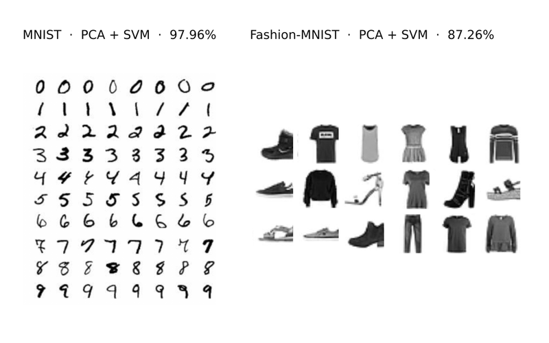
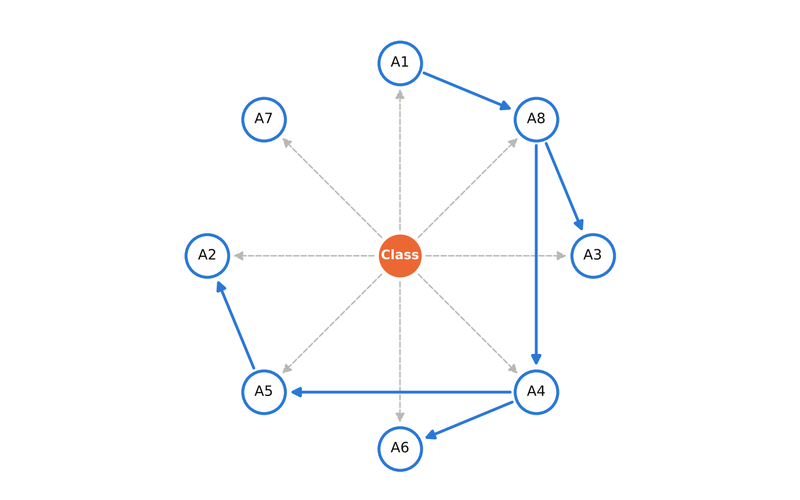
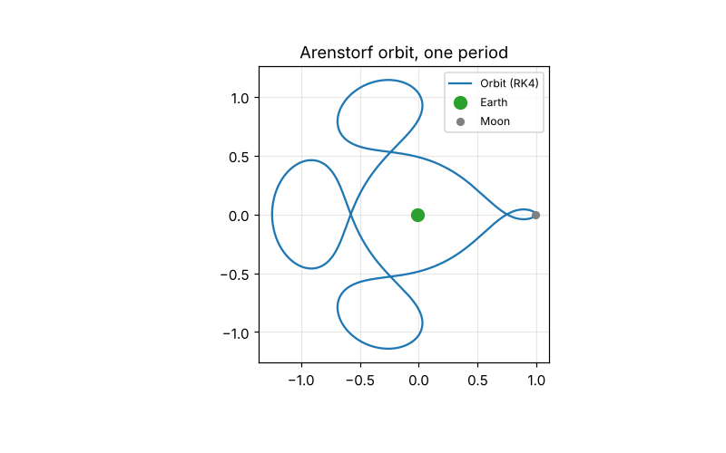
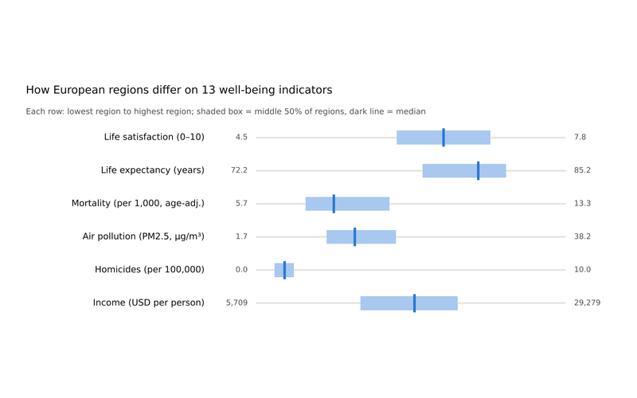
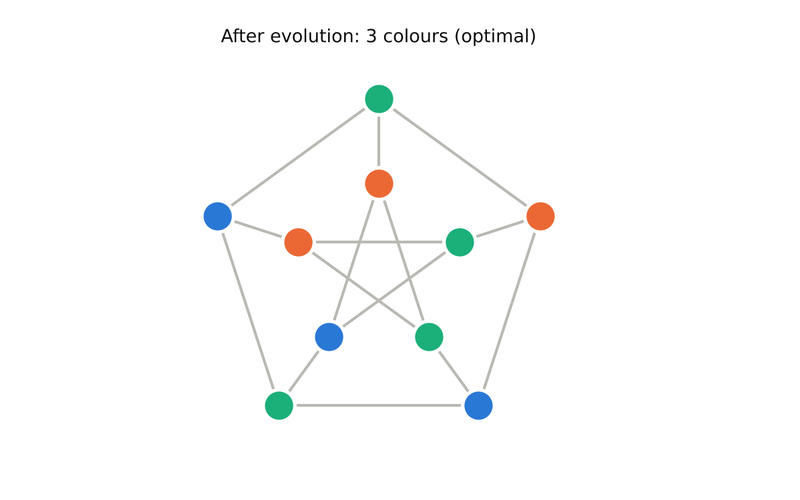
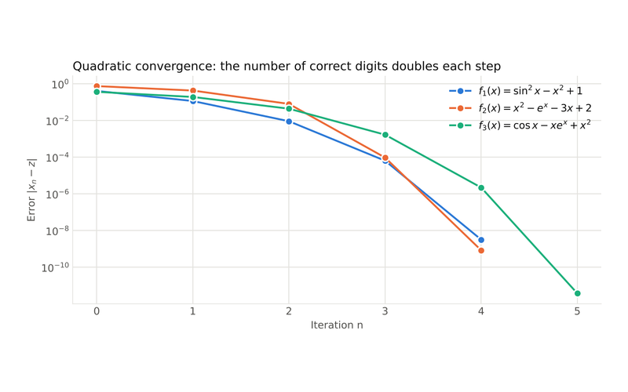

# Hi, I'm Carolina 👋

I'm a first-year **MSc student in Data Science and Engineering** at [Instituto Superior Técnico](https://tecnico.ulisboa.pt/) in Lisbon, with a BSc in **Applied Mathematics and Computation**. I like turning mathematical ideas into working code: machine learning models, numerical simulations, statistical analyses and data pipelines.

## Currently working on

- 🌊 **Chlorophyll-a forecasting:** one-day-ahead prediction of chlorophyll-a from ocean and weather data with regularised linear models and temporal cross-validation (Python, scikit-learn)
- 📈 **Mutual fund style classification:** can a fund's numbers tell whether it is Value, Blend or Growth? Comparing LDA, QDA, FDA and Naive Bayes on 3,000+ US equity funds, with PCA and robust PCA to find what separates the styles (R)
- ☁️ **Cloud resource scheduling:** assigning tasks to contiguous CPU cores in a server cluster to minimise total weighted flow time, framed as a search problem (Python, AI search algorithms)
- 🗄️ **SQL projects:** database design and querying

## Tech

- **Languages:** Python · R · SQL · Java · MATLAB
- **Data:** SQL · data modelling · data analysis and visualisation
- **Areas:** machine learning · statistics · numerical methods · quantitative modelling · simulation
- **Tools:** scikit-learn · pandas · Git · VS Code · Jupyter · RStudio · DataGrip

## Featured projects

| Project | What it does | Stack |
|---|---|---|
| [Supervised Classification (BSc thesis)](https://github.com/carolinasaraivabaptista/supervised-classification-thesis) | From Iris to Fashion-MNIST: LDA, PCA, PCR and SVM, with 98% on MNIST and assumption checks, outliers and model selection on validation data | R, MASS, e1071 |
| [Bayesian Network Classifier](https://github.com/carolinasaraivabaptista/bayesian-network-classifier) | Learns Bayesian networks from data with an MDL-scored hill climber and classifies new cases, up to 97% accuracy | Java, Swing |
| [Numerical Methods for Trajectories](https://github.com/carolinasaraivabaptista/numerical-methods-trajectories) | Drone path planning with splines and kernel smoothing, and satellite orbits with Runge–Kutta solvers | MATLAB |
| [Well-being in European Regions](https://github.com/carolinasaraivabaptista/europe-wellbeing-analysis) | Hypothesis tests and bootstrap confidence intervals on OECD regional data | R, ggplot2, dplyr |
| [Evolutionary Graph Colouring](https://github.com/carolinasaraivabaptista/evolutionary-graph-coloring) | Discrete-event evolutionary simulation that approximates the chromatic number of a graph | Python |
| [Derivative-Free Newton Method](https://github.com/carolinasaraivabaptista/derivative-free-newton) | A Newton variant that needs no derivatives, plus a study of rounding-error amplification | MATLAB |

<table>
<tr>
<td align="center" width="33%"> Supervised classification (R)</td>
<td align="center" width="33%"> Bayesian network classifier (Java)</td>
<td align="center" width="33%"> Numerical trajectories (MATLAB)</td>
</tr>
<tr>
<td align="center" width="33%"> Well-being in Europe (R)</td>
<td align="center" width="33%"> Evolutionary graph colouring (Python)</td>
<td align="center" width="33%"> Derivative-free Newton (MATLAB)</td>
</tr>
</table>

## Get in touch

[LinkedIn](https://www.linkedin.com/in/carolina--baptista/)
